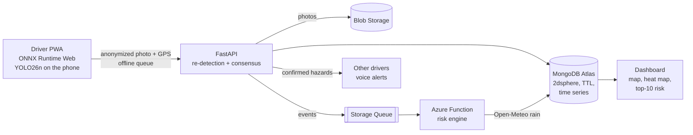

# VíaSegura IA

**The driver's phone as a road sensor.** On-device computer vision detects potholes and
obstacles/landslides, reports are confirmed by consensus across independent devices, and confirmed
hazards are pushed to other drivers (voice alerts, also offline) and to a management dashboard that
ranks road segments by an explainable, equity-aware risk score.

Prototype for the **WFEO Hackathon 2027 — Challenge 3: Smart, Digital and Data-Driven Transport**.
Pilot corridor: Huánuco – Tingo María, Peru (121 km, 13 segments).



## Status

| Phase | Scope | Status |
|---|---|---|
| 0 | Repository, Docker Compose, tests, CI | ✅ |
| 1 | Dataset (RDD2022 + TerrainSense → `pothole`, `obstacle`), training, ONNX export, evaluation | ✅ (short training, see results) |
| 2 | API: reports, consensus (N devices / R m / T min), incidents, segments, stats, media | ✅ 57 tests |
| 3 | Driver PWA: on-device detection, demo video, offline IndexedDB queue, voice alerts | ✅ 22 tests |
| 4 | Dashboard: map, heat map, risk-coloured segments, top-10 table, resolve button | ✅ |
| 5 | Privacy filter on the phone; risk engine with rain + equity rule (Function + local worker) | ✅ 5 tests |
| 6 | Azure deployment script (`infra/deploy.sh`, Azure Cloud Shell) | ✅ written, not yet run end-to-end |
| 7 | Docs: architecture, measured latency, costs, demo script | ⏳ partial (`docs/`) |

## Measured model results (no invented numbers)

`python ml/evaluate.py --by-source` on the **held-out test split** (1,111 images never used in
training; TerrainSense split by whole source video to avoid leakage), deployed ONNX model @ 640 px,
YOLO26n trained for only **7 epochs** on an RTX 3050 (4 GB):

| Class | Test images | Boxes | Precision | Recall | mAP50 | mAP50-95 |
|---|---|---|---|---|---|---|
| all | 1,111 | 2,160 | 0.339 | 0.258 | 0.226 | 0.091 |
| pothole | 1,111 | 1,013 | 0.288 | 0.375 | 0.284 | 0.109 |
| obstacle | 1,111 | 1,147 | 0.391 | 0.140 | 0.168 | 0.073 |
| pothole (RDD2022 road images only) | 631 | 860 | 0.420 | 0.370 | 0.350 | 0.135 |

Raw output: [`ml/results/eval_hazards_test.json`](ml/results/eval_hazards_test.json). These are
early-training numbers; `python ml/train.py` (40 epochs) and the team's own Huánuco–Tingo María
photos are the planned improvement. Consensus across several phones is what keeps false positives
from reaching drivers.

## Quick start (local demo)

Prerequisites: Docker Desktop and Node.js 20+.

```bash
# 1. API + MongoDB + Azurite (Blob/Queue emulator) + risk worker
docker compose up --build            # API on http://localhost:8000/docs

# 2. Driver PWA (phone UI)               -> http://localhost:5173
cd apps/driver-pwa && npm install && npm run dev

# 3. Dashboard                           -> http://localhost:5174
cd apps/dashboard && npm install && npm run dev

# 4. Optional: simulate several phones to see consensus
python scripts/simulate_reports.py --devices 3 --type obstacle --segment HCO-TGM-06
```

In the PWA press **"Modo demo (video)"**: the bundled video (held-out test images) is analysed on
the device, hazards become reports, and they appear in the dashboard. Open the PWA in a second
browser/phone to receive the voice alert. For a one-phone live demo set `CONSENSUS_MIN_DEVICES=1`
in `.env` (production default: 3). Camera and GPS on a real phone need HTTPS (deployed PWA or a
tunnel).

**MongoDB Atlas:** put `ATLAS_MONGODB_URI=mongodb+srv://...` in `.env` (git-ignored) and compose
uses Atlas instead of the local container (database `viasegura`).

## Repository layout

```text
apps/driver-pwa      Driver PWA (React + TS + Vite, ONNX Runtime Web, Service Worker, IndexedDB)
apps/dashboard       Management dashboard (React + TS + MapLibre; Azure Maps tiles via VITE_AZURE_MAPS_KEY)
services/api         FastAPI (Python 3.11, PyMongo Async, onnxruntime), Docker
services/functions   Azure Function (queue + timer) and local worker: segment risk engine
ml/                  prepare_dataset.py, train.py, export_onnx.py, evaluate.py, make_demo_video.py
scripts/             build_segments.py (OSM + INEI), simulate_reports.py, make_pwa_assets.py
docs/                decisions.md (deviations from the brief and why)
```

## How it works

1. **On the phone** (works in airplane mode): YOLO26n (NMS-free, 9.9 MB ONNX) runs in a Web Worker;
   a hazard is reported only if seen in 2 of 3 analysed frames, with distance/time cool-down.
   Obstacles need ≥ 45 % confidence.
2. **Context model**: a second, COCO-pretrained YOLO26n recognises people and vehicles. "Obstacle"
   detections that are really a person or a vehicle are discarded (drawn as "ignorado" in the
   video), and people/vehicles are pixelated in every uploaded photo.
3. **Privacy by design**: only a ≤480 px crop leaves the phone; everything outside the hazard box is
   pixelated, the hazard is rendered from ≤280 px, people and vehicles are pixelated; canvas
   re-encoding drops EXIF/GPS; the server re-encodes again. Device ids rotate daily.
4. **Offline-first**: reports go to an IndexedDB outbox and sync when signal returns; the API is
   idempotent on `(deviceId, clientReportId)`, so retries never double count.
5. **Server re-detection** with the same ONNX model: `confirmed` when it sees the hazard, otherwise
   `unconfirmed` (still counted; consensus is the main defence). `SERVER_CHECK_REJECTS=true`
   excludes unconfirmed photos instead.
6. **Consensus**: an incident is confirmed when N distinct devices report the same type within R
   metres and T minutes (`CONSENSUS_MIN_DEVICES`, `CONSENSUS_RADIUS_M`, `CONSENSUS_WINDOW_MIN`).
7. **Risk** per segment = 60 % incidents + 25 % rain (Open-Meteo, 72 h) + 15 % history,
   × (1 + 0.5 × isolationIndex). Traffic never lowers priority (equity rule); every score stores its
   breakdown.
8. **Dashboard map**: street map (OpenStreetMap) or satellite imagery (Esri) without any key —
   Azure Maps tiles when `VITE_AZURE_MAPS_KEY` is set. Clicking any point of the road opens Google
   Street View at that exact place (link, no API key), so road managers can see the street.

## Data sources and licences

- RDD2022 (Arya et al.), CC BY 4.0 — potholes (class D40). Read remotely with HTTP Range requests.
- TerrainSense (Bhute, Rane, Joshi), CC BY 4.0 — obstacles.
- OpenStreetMap (ODbL) via OSRM/Nominatim — corridor geometry and districts.
- INEI Censo 2017 — district population (`populationServed`).
- Open-Meteo (CC BY 4.0) — precipitation.
- Ultralytics YOLO is AGPL-3.0; this repository is therefore published as open source.

## Tests

```bash
cd services/api && pytest            # 57 tests (integration tests need MongoDB: docker compose up)
cd apps/driver-pwa && npm test       # 22 tests
python -m pytest services/functions/tests   # 5 tests (risk formula, equity rule)
```

## Known limitations

- The model was trained for 7 epochs only (time box); obstacle recall is low. More epochs and local
  photos are expected to improve it — re-run `ml/train.py` + `ml/evaluate.py`.
- Consensus serialises incident creation per process; with several API replicas two simultaneous
  first reports could open two incidents.
- Plates/faces inside the hazard box are protected by resolution reduction, not by a dedicated
  detector.
- `infra/deploy.sh` has not been run end-to-end yet; the first deployment may need small adjustments.
- Measured locally (headless Chrome, two simulated phones, `CONSENSUS_MIN_DEVICES=1`): demo video → report → confirmed incident → alert on the second phone in 11.9 s (dominated by the 15 s refresh of nearby hazards).
